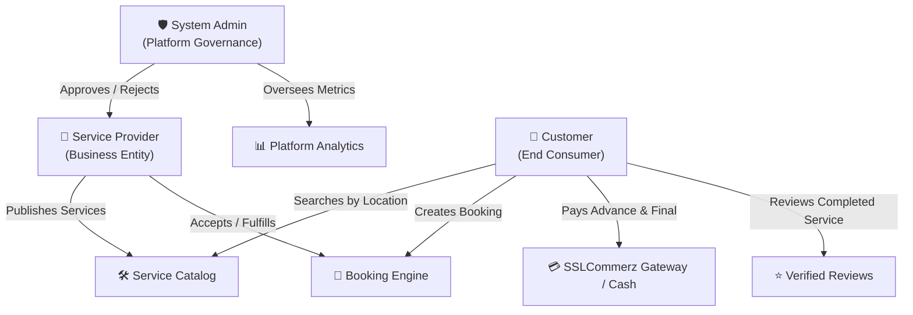
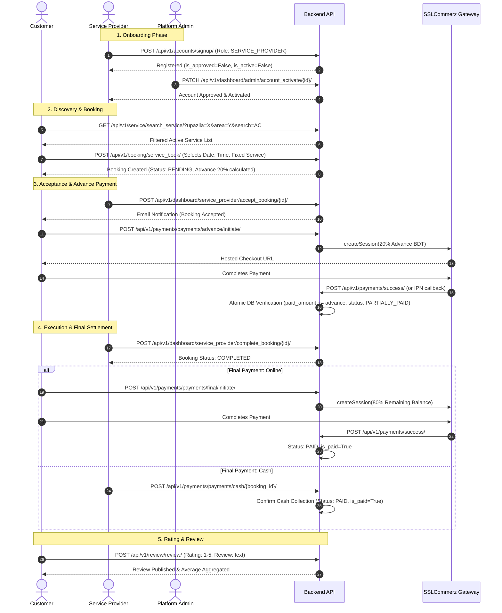

# 🏙️ Local Service Finder System - Project Overview

> **Document ID:** `DOC-01-OVERVIEW`  
> **System Version:** 1.0.0  
> **Backend Framework:** Django 6.0.3 / Django REST Framework 3.17.1  
> **Target Region:** Bangladesh (Division → District → Upazila → Local Area)

---

## 1. Executive Summary

The **Local Service Finder System** is a production-grade, API-first marketplace platform engineered to bridge the gap between local service consumers (Customers) and hyper-local service technicians and businesses (Service Providers). Operating primarily within a hierarchical municipal structure (Divisions, Districts, Upazilas, and localized neighborhoods), the system eliminates search frictions, opaque pricing, and trust deficits typical of informal local service markets.

The system features robust identity management, multi-role access control, a multi-stage booking lifecycle engine, automated email notifications, an escrow-like two-phase payment framework integrated with **SSLCommerz** (supporting both online transactions and verified cash on delivery), Cloudinary media management, and authentic booking-gated ratings and reviews.

---

## 2. Problem Statement & Mission

### The Problem
In many developing and suburban metropolitan landscapes, finding reliable local technicians (such as electricians, plumbers, appliance repair technicians, home cleaners, and carpenters) is fragmented, decentralized, and fraught with risk:
- **Zero Transparency:** Customers face unpredictable hourly or arbitrary pricing.
- **Geographic Mismatches:** Consumers struggle to identify providers available specifically within their local union or upazila.
- **Provider Reliability:** Service providers frequently face late cancellations, while customers risk non-delivery after unverified upfront cash demands.
- **Lack of Accountability:** Unverified word-of-mouth recommendations provide no recourse or verifiable review history.

### The Mission
The Local Service Finder System standardizes and digitizes local service discovery, ordering, payment settlement, and provider reputation tracking through:
1. **Precise Geo-Targeting:** Restricting service search to specific Upazilas and local areas to ensure prompt physical dispatch.
2. **Two-Stage Escrow-Style Payments:** Securing a mandatory 20% advance payment to confirm bookings before service execution, followed by automated settlement upon completion.
3. **Verified Feedback Loops:** Allowing only verified customers who completed a booking to submit ratings and reviews.
4. **Administrative Governance:** Ensuring all service providers undergo administrative vetting before their listings go live.

---

## 3. Core System Personas & User Roles

The platform enforces Role-Based Access Control (RBAC) across three distinct actors:

### 1. Customer (`CUSTOMER`)
- Registers instantly and receives immediate account activation.
- Discovers services filtered by Category, Upazila, Area, and descriptive keywords.
- Books services with scheduled dates and times.
- Pays a mandatory 20% advance via SSLCommerz once the provider accepts the booking.
- Settles the remaining 80% either via online gateway or verified cash upon job completion.
- Submits authentic 1–5 star reviews with textual feedback for completed bookings.

### 2. Service Provider (`SERVICE_PROVIDER`)
- Registers with detailed business information, coverage zones (Division, District, Upazila, Area), and bio.
- **Gated Onboarding:** Account defaults to `is_active=False` and `is_approved=False` until vetted by an Admin.
- Publishes services categorized by pricing structures (Fixed, Hourly, Custom Quotation).
- Manages incoming booking requests (accepts or rejects bookings).
- Executes services, marks bookings as completed, and confirms cash collection when cash payment is chosen.

### 3. Administrator (`ADMIN`)
- Holds full administrative oversight across all system domains.
- Reviews pending service provider applications and toggles approval/activation status.
- Manages reference location data (Divisions, Districts, Upazilas) and global categories.
- Monitors overall platform performance, total orders, activation counts, and payment logs.

---

## 4. Key Value Propositions

| Pillar | Capability | Technical Realization |
|---|---|---|
| **Hyper-Local Discovery** | Query services by exact Upazila and neighborhood area. | Indexed lookup queries (`provider__upazila`, `provider__area`) linked to structured geographic models. |
| **Two-Phase Financial Flow** | 20% advance upon acceptance + 80% balance upon completion. | Atomic database transactions, Decimal rounding arithmetic, and SSLCommerz session orchestration. |
| **Fraud-Resistant Reviews** | 100% verified review attribution. | `ReviewAndRating` model linked to `Booking` via a `OneToOneField` requiring `COMPLETED` booking status. |
| **Media Cloud Storage** | High-performance image storage for service banners and user profiles. | Cloudinary SDK integration (`CloudinaryField`) with secure CDN delivery. |
| **Self-Service Recovery** | 5-minute time-decaying OTP password resets. | Random 4-digit code generation, SMTP HTML dispatch, and expiration tracking. |

---

## 5. Technology Stack Summary

### Backend Core
- **Language:** Python 3.12 / 3.13 / 3.14 compatible
- **Web Framework:** Django 6.0.3 / 6.0.6
- **API Framework:** Django REST Framework (DRF) 3.17.1
- **Database Engine:** SQLite (Development) / PostgreSQL compatible via `dj-database-url`
- **Authentication:** JWT via `djangorestframework-simplejwt 5.5.1` (with Token Blacklisting)

### External Integrations & Services
- **Payment Gateway:** SSLCommerz (`sslcommerz-lib 1.0`) with IPN Webhook validation and MD5 signature verification.
- **Media Asset Storage:** Cloudinary (`cloudinary`) for cloud-hosted profile images and service thumbnails.
- **Email Infrastructure:** Django SMTP Backend via Google Gmail TLS (port 587) for transactional emails and OTP verification.
- **API Documentation:** `drf-yasg 1.21.18` delivering interactive Swagger UI (`/swagger/`) and ReDoc (`/redoc/`).

---

## 6. End-to-End System Workflow

---

## 7. Documentation Roadmap

This document serves as the entry point to the complete system documentation suite:

| File | Title | Description |
|---|---|---|
| `01_project_overview.md` | **Project Overview** | Vision, mission, core pillars, and high-level workflows. |
| `02_project_context.md` | **Project Context** | Background, business constraints, operational rules, and domain policies. |
| `03_project_features.md` | **Feature Catalog** | Exhaustive functional specifications for all 9 platform subsystems. |
| `04_frontend_ai_workflow.md` | **Frontend AI Workflow** | Integration handbook, state transitions, client screens, and UI guidelines. |
| `05_code_standards.md` | **Code Standards** | Backend design patterns, database transaction safety, formatting, and security. |
| `06_api_documentation.md` | **API Reference** | Complete endpoint catalogue with request/response schemas and auth specs. |
| `07_project_architecture.md` | **System Architecture** | Technical blueprint, ER diagrams, data flow topology, and deployment layout. |
