# 🌐 Local Service Finder System - Project Context

> **Document ID:** `DOC-02-CONTEXT`  
> **System Version:** 1.0.0  
> **Context:** Municipal Service Discovery, On-Demand Booking, Multi-Stage Escrow Settlements

---

## 1. Domain Background & Environmental Context

### 1.1 The Local Service Industry Landscape
In South Asian urban and semi-urban markets (specifically Bangladesh), local home services—such as electrical repairs, plumbing, HVAC maintenance, carpentry, domestic painting, and IT hardware troubleshooting—are traditionally operated through unorganized, informal networks. Customers rely on informal referrals or physical market scouting, leading to several friction points:
- **Geographic Fragmentation:** Service providers operate within narrow radius bounds (e.g., specific Upazilas or Thanas), but customers lack unified directories to confirm whether a provider can physically service their address.
- **Arbitrary Price Fluctuations:** Without standardized catalog pricing or advance commitments, prices fluctuate heavily based on customer urgency or perceived purchasing power.
- **No-Show and Cancellation Risk:** Customers regularly experience unannounced provider cancellations. Conversely, providers lose billable hours traveling to client locations only to face customer cancellations upon arrival.
- **Payment Collection Inefficiencies:** Cash collection upon service delivery lacks transaction trails, refund security, or dispute mediation mechanisms.

### 1.2 Administrative Geographic Hierarchy
To accommodate operational realities in Bangladesh, the system model mirrors the official administrative geo-structure:
```
Division (e.g., Dhaka, Chittagong, Rajshahi)
  └── District (e.g., Dhaka, Gazipur, Narayanganj)
        └── Upazila / Thana (e.g., Mirpur, Dhanmondi, Gulshan, Savar)
              └── Local Area / Ward (e.g., Block D, Sector 7, Road 12)
```
Every service provider profile and service search is linked directly to this hierarchy, guaranteeing that search results represent actionable, physically viable service matches.

---

## 2. Business Objectives & System Scope

### 2.1 Core Objectives
1. **Digitize Provider Discovery:** Allow customers to filter qualified service providers within their local district and upazila in seconds.
2. **Eliminate No-Shows via Two-Stage Commitment:** Implement a mandatory **20% advance payment** collected online after the provider accepts the booking. This financial commitment drastically reduces frivolous bookings and unfulfilled visits.
3. **Flexible Settlement:** Support dual final payment options (online payment through SSLCommerz or verified in-person cash payment confirmed by the provider).
4. **Enforce Trust through Administrative Gatekeeping:** Require manual review and approval by platform admins before any service provider can offer public listings.
5. **Authentic Post-Service Reputation:** Guarantee that 100% of published reviews are backed by verified, completed transactions.

### 2.2 System Scope

```mermaid
graph TD
    subgraph IN_SCOPE ["In Scope (System Capabilities)"]
        direction TB
        A1["RBAC Identity & JWT Auth"]
        A2["Hierarchical Geo-Location Engine"]
        A3["Service Catalog with Fixed/Hourly/Quotation types"]
        A4["State-Machine Driven Booking Lifecycle"]
        A5["Two-Stage Payment Settlement (SSLCommerz & Cash)"]
        A6["Transactional Email Notifications & Decaying OTP"]
        A7["Cloudinary Media Asset Storage"]
        A8["Verified 1-to-1 Booking Reviews"]
        A9["Role-Specific Analytics Dashboards"]
    end

    subgraph OUT_OF_SCOPE ["Out of Scope (Deferred / External)"]
        direction TB
        B1["In-App Real-Time WebRTC / Chat Messaging"]
        B2["Live GPS Telemetry & Real-Time Driver Tracking"]
        B3["Automated Algorithmic Quotation Negotiation"]
        B4["Multi-Currency FX Processing (BDT Only)"]
        B5["Automated Sub-Merchant Bank Payouts"]
    end
```



---

## 3. Core Business Domain Rules

The platform implements rigorous business domain invariants across all modules:

### 3.1 Identity & Provider Onboarding Rules
- **Email As Primary Identifier:** The traditional Django `username` field is removed (`username = None`). The user's unique `email` is enforced as the sole credential (`USERNAME_FIELD = "email"`).
- **Service Provider Gating:**
  - Upon registration, if `role == "CUSTOMER"`, the account is automatically activated (`is_approved = True`, `is_active = True`).
  - If `role == "SERVICE_PROVIDER"`, the account is initialized in an unapproved state (`is_approved = False`, `is_active = False`). No JWT token is granted until an Admin executes the activation patch (`/api/v1/dashboard/admin/account_activate/{pk}/`).
- **One-To-One Profile Binding:** Every registered `CustomUser` automatically receives a linked `Profile` instance generated via Django `post_save` signals.

### 3.2 Booking Lifecycle Invariants
The booking lifecycle strictly adheres to state machine rules:
1. **Creation Prerequisites:** Only users with `role == "CUSTOMER"` can book services. Services must have `is_active == True`.
2. **Pricing Restrictions at Booking:**
   - `FIXED`: Allowed for direct booking. Total price equals `service.base_price`.
   - `HOURLY`: Direct booking is rejected (`400 Bad Request`) because total hours/duration must be established prior to total price calculation.
   - `QUOTATION`: Direct booking is rejected (`400 Bad Request`) pending provider quotation.
3. **Mandatory 20% Advance Calculation:**
   $$\text{Advance Amount} = \text{Round}\left(\text{Price at Booking} \times 0.20, 2\right)$$
4. **Modification and Cancellation Boundaries:**
   - Bookings can only be modified (time, date, note) or cancelled by the customer while their status is strictly `pending`.
   - Once a provider accepts a booking (`accepted`), the customer cannot arbitrarily cancel it via the public cancellation endpoint.

### 3.3 Two-Stage Payment & Settlement Invariants
- **Phase 1: Advance Payment (Online Only):**
  - Triggered exclusively after the provider transitions the booking to `accepted`.
  - Amount must exactly match `booking.advance_amount` (20% of total).
  - Can only be initiated if `paid_amount == 0.00`.
- **Phase 2: Final Settlement (Online or Cash):**
  - Can only be initiated once the provider transitions the booking to `completed`.
  - **Online Route:** Remaining balance ($\text{Price at Booking} - \text{Paid Amount}$) processed through SSLCommerz session.
  - **Cash Route:** Service provider collects cash in person and hits `/api/v1/payments/payments/cash/{booking_id}/` to confirm receipt.
- **Double-Spend & Concurrency Protection:**
  - All payment checks and balance updates execute within `@transaction.atomic` blocks with row-level database locks (`select_for_update()`).
  - Concurrent payment attempts for the same booking and purpose return `409 Conflict`.
- **Financial Precision:** Floating-point math is strictly prohibited for monetary calculations. All amounts are processed as `Decimal` with 2 decimal places (`ROUND_HALF_UP`).

### 3.4 Review & Rating Rules
- **Verified Purchase Enforcement:** Reviews cannot be created directly against a service in isolation; they must point to a specific `Booking` (`OneToOneField(Booking)`).
- **Completion Requirement:** Only bookings with `status == "completed"` and valid customer ownership are eligible for review.
- **Rating Bounds:** Numerical rating is bounded between $1$ and $5$ inclusive (`MinValueValidator(1), MaxValueValidator(5)`).
- **Single Review Constraint:** A customer can submit at most one review per completed booking.

---

## 4. External Dependencies & Operational Assumptions

| Dependency | Purpose | Failure Mode & Fallback Strategy |
|---|---|---|
| **SSLCommerz Payment Gateway** | Processes credit cards, debit cards, mobile financial services (bKash, Nagad, Rocket). | Returns `502 Bad Gateway` if unreachable. Initiated payment attempts fail cleanly; IPN webhook handles delayed confirmations with MD5 signature validation. |
| **Cloudinary Media Storage** | Hosts profile photos and service cover banners. | Handled via `CloudinaryField`. If credentials are unset or upload fails, default placeholder URLs or local files are used during development. |
| **Gmail SMTP Server** | Dispatches OTP verification codes and transactional booking updates. | In non-critical booking emails, exceptions are suppressed with `try...except` so booking creation does not crash if email fails. OTP dispatch reports `400/500` if email delivery fails. |
| **PostgreSQL / SQLite Database** | Relational data persistence with foreign keys and cascade delete logic. | Configured via `dj_database_url` driven by the `DATABASE_URL` environment variable. |

---

## 5. Security & Trust Boundaries

1. **Authentication Token Lifecycle:**
   - Stateless JWT authentication via `rest_framework_simplejwt`.
   - Access tokens expire after **60 minutes**; refresh tokens expire after **60 days**.
   - Logout invokes SimpleJWT token blacklisting (`RefreshToken.blacklist()`).
2. **Password Security & Recovery:**
   - Django PBKDF2 with SHA-256 password hashing.
   - Password reset requires a 4-digit numeric OTP generated via `random.randint(2222, 9999)` with a strict **5-minute decay window** (`timezone.now() > create_at + 5 minutes`).
3. **Webhook Verification (IPN):**
   - SSLCommerz Instant Payment Notification (IPN) validates incoming payloads by constructing an MD5 hash incorporating the store password and comparing it against the incoming `verify_sign` HMAC digest.
4. **Environment Isolation:**
   - All secrets (`SECRET_KEY`, `DATABASE_URL`, `SSLCOMMERZ_STORE_ID`, `SSLCOMMERZ_STORE_PASSWORD`, `CLOUDINARY_*`, `EMAIL_HOST_PASSWORD`) are loaded strictly from the system environment or a root `.env` via `python-decouple`.
