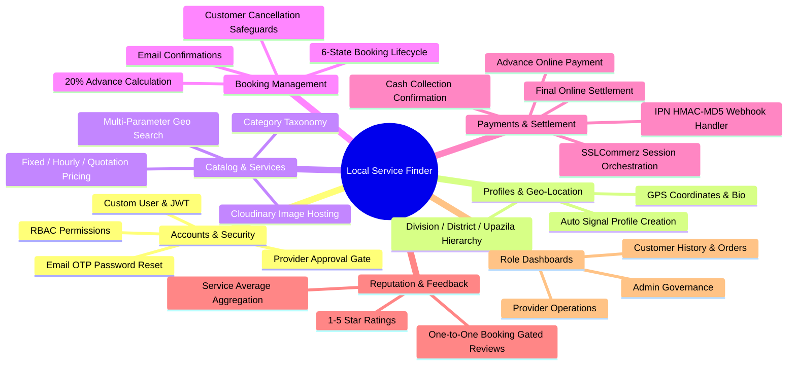
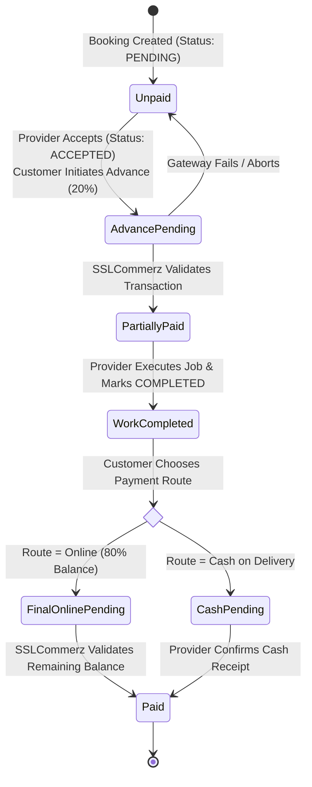

# 🚀 Local Service Finder System - Project Features Catalog

> **Document ID:** `DOC-03-FEATURES`  
> **System Version:** 1.0.0  
> **Target Audience:** Developers, Technical Product Managers, System Architects

---

## 1. Feature Map Overview

The Local Service Finder System is composed of **9 functional domains**:

---

## 2. Accounts & Security Subsystem

The `accounts` application manages credentials, role-based identity, session lifecycle, and authentication tokens.

### 2.1 Custom User Management
- **Model:** `CustomUser(AbstractUser)`
- **Key Attributes:**
  - `email`: Enforced as unique primary identifier (`USERNAME_FIELD = "email"`).
  - `role`: Choices include `CUSTOMER`, `SERVICE_PROVIDER`, `ADMIN`. Defaults to `CUSTOMER`.
  - `first_name` & `last_name`: Auto-concatenated into a read-only `name` field upon `save()`.
  - `division`, `district`, `upazila`, `area`: Direct foreign keys associating users with geographical zones.
  - `is_approved` & `is_active`:
    - `CUSTOMER`: `is_approved=True`, `is_active=True` upon registration.
    - `SERVICE_PROVIDER`: `is_approved=False`, `is_active=False` upon registration, awaiting Admin vetting.

### 2.2 JWT Authentication & Session Token Lifecycle
- Handled through `rest_framework_simplejwt`.
- **Endpoints:**
  - `POST /api/v1/accounts/signup/`: Public registration with role-based branching.
  - `POST /api/v1/accounts/signin/`: Returns pair `{access_token, refresh_token}` for valid credentials.
  - `POST /api/v1/accounts/signout/`: Requires access token; receives `{refresh}` in body and registers it to the token blacklist (`RefreshToken.blacklist()`).
  - `POST /api/v1/accounts/change_password/`: Authenticated user provides `old_password` and `new_password`.

### 2.3 Time-Decaying OTP Password Recovery
- **Model:** `OTP`
- **Mechanism:**
  - `POST /api/v1/accounts/send_otp/`: Takes `{email}`. If the account exists, generates a cryptographically random 4-digit code ($2222 - 9999$).
  - Dispatches a branded HTML email via Gmail SMTP with an explicit 5-minute validity warning.
  - `POST /api/v1/accounts/reset_password/`: Takes `{email, otp, new_password}`. Verifies matching OTP and checks `is_expire()` ($> 5$ minutes). If valid, updates password with `user.set_password()` and purges the OTP record.

### 2.4 Granular RBAC Permission Classes
Implemented in `accounts/permission.py`:
- `IsAdmin`: `request.user.role == "ADMIN"`.
- `IsServiceProvider`: `request.user.role == "SERVICE_PROVIDER"`.
- `IsCustomer`: `request.user.role == "CUSTOMER"`.
- `IsAdminORServiceProvider`: `request.user.role in ("ADMIN", "SERVICE_PROVIDER")`.

---

## 3. Profiles & Geographic Hierarchy Subsystems

### 3.1 Extended Profiles (`profiles`)
- **Model:** `Profile`
- **Signal-Driven Automation:** Every user creation triggers `post_save` in `profiles/signals.py`, creating an associated `Profile` record automatically.
- **Attributes:**
  - `image`: Cloudinary-managed profile photo (`CloudinaryField`).
  - `gender`: `MALE`, `FEMALE`, `OTHER`.
  - `city`, `area`, `phone`, `bio`: Contact and descriptive metadata.
  - `experience`: Integer field representing years in business/trade.
  - `is_verified` & `is_available`: Badges and real-time operational status.
  - `latitude` & `longitude`: Float coordinates for geospatial mapping.
- **Capabilities:**
  - `GET /api/v1/profiles/get_all_profile/`: Paginated list of profiles (`ProfilePagination`, 10 per page).
  - `GET /api/v1/profiles/get_profile/`: Retrieves the caller's own profile.
  - `PATCH /api/v1/profiles/modify_profile/`: Updates bio, phone, coordinates, and photo.
  - `GET /api/v1/profiles/search/?search=<query>`: Multi-column search across `first_name`, `last_name`, `city`, and `area`.

### 3.2 Geographic Taxonomy (`locations`)
- **Models:**
  - `Division`: Top-level administrative unit (e.g., Dhaka, Chittagong).
  - `District`: Mid-level unit linked to `Division` via `ForeignKey(Division, on_delete=CASCADE)`.
  - `Upazila`: Municipal or sub-district unit linked to `District` via `ForeignKey(District, on_delete=CASCADE)`.
- **Capabilities:**
  - Full CRUD operations restricted to `ADMIN` (`create_*`, `update_*`, `delete_*`).
  - Public listing endpoints (`division_list/`, `district_list/`, `upazila_list/`) enabling cascading dropdowns in frontend forms.

---

## 4. Categories & Service Catalog Subsystems

### 4.1 Service Categories (`categories`)
- **Model:** `Category` (`name` unique string, foreign key to user creator).
- **Capabilities:**
  - Admin-managed taxonomy (`create_category/`, `category_modify/{id}/`).
  - Public listing and search (`all_category/`, `category_search/?search=<term>`).

### 4.2 Service Catalog (`service`)
- **Model:** `Service`
- **Attributes:**
  - `provider`: Foreign key to `CustomUser`.
  - `name`: Indexed string (max length 200).
  - `image`: Cloudinary media field.
  - `category`: Linked `Category`.
  - `pricing_type`:
    - `fixed`: Standardized fixed job cost (`base_price`).
    - `hourly`: Billed per hour (`hour_base_price`).
    - `quotation`: Custom estimates based on inspection.
  - `is_active`: Operational toggle.
- **Capabilities:**
  - `GET /api/v1/service/all_service/`: Global paginated public catalog.
  - `GET /api/v1/service/services/`: Provider's self-owned service listing.
  - `POST /api/v1/service/services/`: Provider publishes a new service with `MultiPartParser` support.
  - `PATCH / DELETE /api/v1/service/service_modify/{id}/`: Provider or Admin modifies/deletes a listing.
  - `GET /api/v1/service/search_service/?upazila=X&area=Y&search=Z`: **Hyper-Local Discovery Engine**:
    - Enforces exact match against provider's registered location (`provider__area__exact` and `provider__upazila__exact`).
    - Filters across `name`, `description`, or `category__name` with case-insensitive `icontains`.
    - Returns paginated responses via `MyPageNumberPagination`.

---

## 5. Booking Lifecycle Engine (`booking`)

The booking subsystem governs interactions between Customers and Service Providers.

### 5.1 Booking Model Architecture
- **Model:** `Booking`
- **Statuses (`Status`):**
  - `pending`: Newly booked by customer; awaiting provider action.
  - `accepted`: Provider agreed to job; customer eligible to pay advance.
  - `rejected`: Provider declined booking.
  - `in_progress`: Technician actively executing work.
  - `completed`: Work finished; ready for final settlement.
  - `cancelled`: Customer aborted booking before provider acceptance.
- **Payment Statuses (`PaymentStatus`):**
  - `unpaid`, `pending`, `partially_paid` (advance paid), `paid`, `failed`, `refunded`.
- **Key Fields:**
  - `price_at_booking`: Snapshot of base price at the moment of reservation.
  - `advance_amount`: Calculated mandatory 20% advance ($0.20 \times \text{base\_price}$).
  - `paid_amount`: Running ledger of money received.
  - `remaining_amount`: Dynamic property: $\max(\text{price\_at\_booking} - \text{paid\_amount}, 0)$.

### 5.2 Booking Actions & State Flow
- `POST /api/v1/booking/service_book/`:
  - Validates service is `is_active`.
  - Validates pricing is `fixed` (hourly/quotation require prior agreement).
  - Auto-computes 20% advance.
  - Sends immediate HTML/plain confirmation email to customer.
- `PATCH /api/v1/booking/booking_update/{pk}/`:
  - Allowed **only** while booking is `pending`.
- `POST /api/v1/booking/cancel_booking/{pk}/`:
  - Allowed **only** while booking is `pending`. Records `cancelled_by`, `cancelled_at`, and `cancellation_reason`.
- `GET /api/v1/booking/my_bookings/`:
  - Customer views their historical and active orders.
- `GET /api/v1/booking/get_all_booking/`:
  - Provider inspects all bookings assigned to their services.

---

## 6. Two-Stage Payment & Gateway Subsystem (`payments`)

Engineered with the SSLCommerz library (`sslcommerz-lib`) to handle secure digital transactions and verified cash settlement.

### 6.1 Payment Initiation Endpoints
1. **Advance Initiation (`POST /api/v1/payments/payments/advance/initiate/`):**
   - Customer provides `{booking_id}`.
   - Verifies `booking.status == ACCEPTED` and `paid_amount == 0`.
   - Creates a `Payment` record with `purpose = ADVANCE` and `amount = advance_amount`.
   - Generates an SSLCommerz hosted checkout session; returns `gateway_url`.
2. **Final Online Initiation (`POST /api/v1/payments/payments/final/initiate/`):**
   - Customer provides `{booking_id}`.
   - Verifies `booking.status == COMPLETED` and `final_payment_method == ONLINE`.
   - Creates a `Payment` record with `purpose = FINAL` and `amount = remaining_amount`.
   - Generates an SSLCommerz checkout session; returns `gateway_url`.
3. **Cash Confirmation (`POST /api/v1/payments/payments/cash/{booking_id}/`):**
   - Called by the **Service Provider** upon physical cash handover.
   - Validates `booking.status == COMPLETED` and `final_payment_method == CASH`.
   - Atomically updates `paid_amount = total`, `payment_status = PAID`, and `is_paid = True`.

### 6.2 Transaction Verification & Webhooks
- **Success Callback (`POST /api/v1/payments/success/`):**
  - Receives `tran_id` and `val_id` from SSLCommerz.
  - Queries SSLCommerz Order Validation API.
  - Validates status `VALID`/`VALIDATED`, BDT currency, and exact amount match.
  - Updates `paid_amount`, transitions booking to `PARTIALLY_PAID` or `PAID`.
- **IPN Handler (`POST /api/v1/payments/ipn/`):**
  - Authenticates gateway payload using HMAC-MD5 signature verification against `store_passwd`.
  - Confirms state asynchronously to ensure payments are recorded even if the user drops off before redirection.
- **Detail & Status Check (`GET /api/v1/payments/status/{payment_id}/`):**
  - Returns real-time financial status, remaining balance, and paid totals.

---

## 7. Reviews & Ratings Subsystem (`reviews`)

### 7.1 Architecture & Business Logic
- **Model:** `ReviewAndRating`
- **Fields:** `booking` (`OneToOneField`), `service` (`ForeignKey`), `user` (`ForeignKey`), `rating` (Integer, 1–5), `review` (Text, up to 1000 characters).
- **Integrity Safeguard:** By binding reviews directly to `Booking` through a `OneToOneField`, a user can never fabricate reviews without an actual completed booking, and duplicate reviews for a single service visit are structurally impossible.

### 7.2 Capabilities
- `POST /api/v1/review/review/`: Customer submits rating and feedback.
- `PATCH / DELETE /api/v1/review/update_review/{pk}/` & `delete_review/{pk}/`: Modify or remove customer's own review.
- `GET /api/v1/review/get_review/{service_id}/`: Public list of all reviews for a service.
- `GET /api/v1/review/get_average_review_rating/{service_id}/`: Calculates arithmetic mean of ratings and total review count.

---

## 8. Role-Based Dashboards (`dashboard`)

### 8.1 Admin Dashboard (`dashboard.urls.admin_urls`)
- `GET /api/v1/dashboard/admin/admin/`: Admin landing status check.
- `GET /api/v1/dashboard/admin/pending_account/`: Lists all unapproved service providers (`is_approved=False, role='SERVICE_PROVIDER'`).
- `PATCH /api/v1/dashboard/admin/account_activate/{pk}/`: Approves and activates a provider's account (`is_approved=True, is_active=True`).
- `GET /api/v1/dashboard/admin/total_activate_account_count/`: Count of active accounts.
- `GET /api/v1/dashboard/admin/total_activate_pending_count/`: Count of pending applications.

### 8.2 Service Provider Dashboard (`dashboard.urls.service_provider_urls`)
- `GET /api/v1/dashboard/service_provider/service_provide/`: Provider landing status check.
- `GET /api/v1/dashboard/service_provider/get_pending_booking/`: Incoming queue of customer booking requests.
- `POST /api/v1/dashboard/service_provider/accept_booking/{pk}/`: Accepts booking; triggers notification email to customer with advance payment instructions.
- `POST /api/v1/dashboard/service_provider/reject_booking/{pk}/`: Rejects booking; notifies customer via email.
- `POST /api/v1/dashboard/service_provider/complete_booking/{pk}/`: Marks service completed; unlocks final settlement.
- `GET /api/v1/dashboard/service_provider/get_accept_booking/`: List of currently accepted/ongoing jobs.
- `GET /api/v1/dashboard/service_provider/total_accept_booking/` & `total_completed_booking/`: Performance metrics.

### 8.3 Customer Dashboard (`dashboard.urls.customer_urls`)
- `GET /api/v1/dashboard/customer/customer/`: Customer landing status check.
- `GET /api/v1/dashboard/customer/total_oder_list/`: Full history of all orders.
- `GET /api/v1/dashboard/customer/pending_booking/`: Orders currently awaiting provider action.
- `GET /api/v1/dashboard/customer/completed_booking/`: Orders completed and ready for review.
