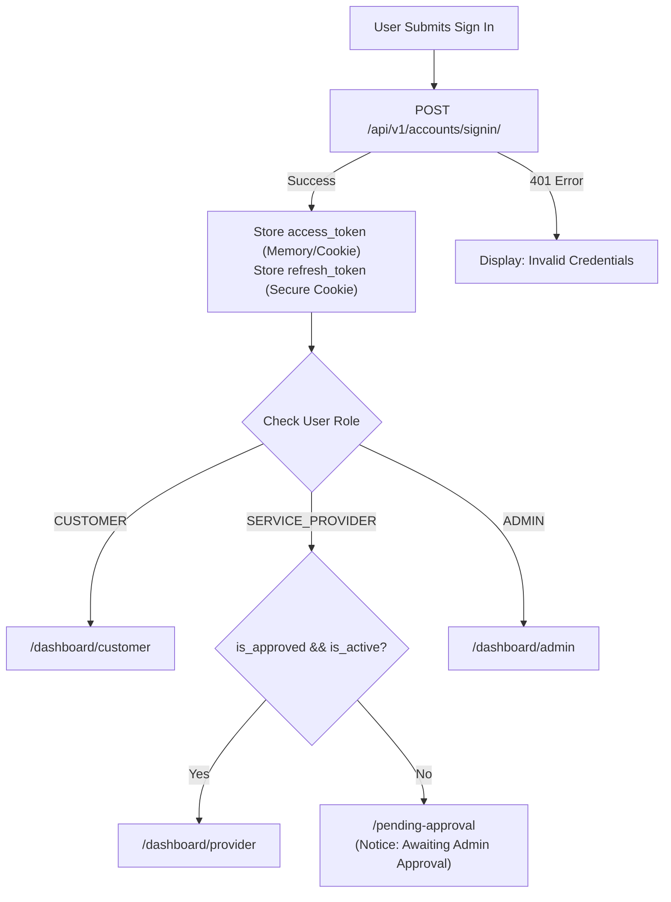
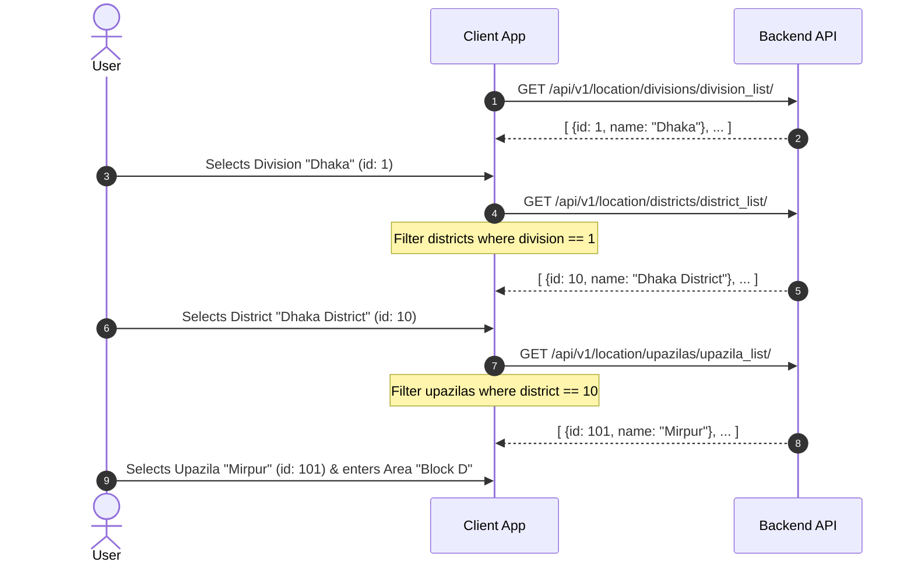
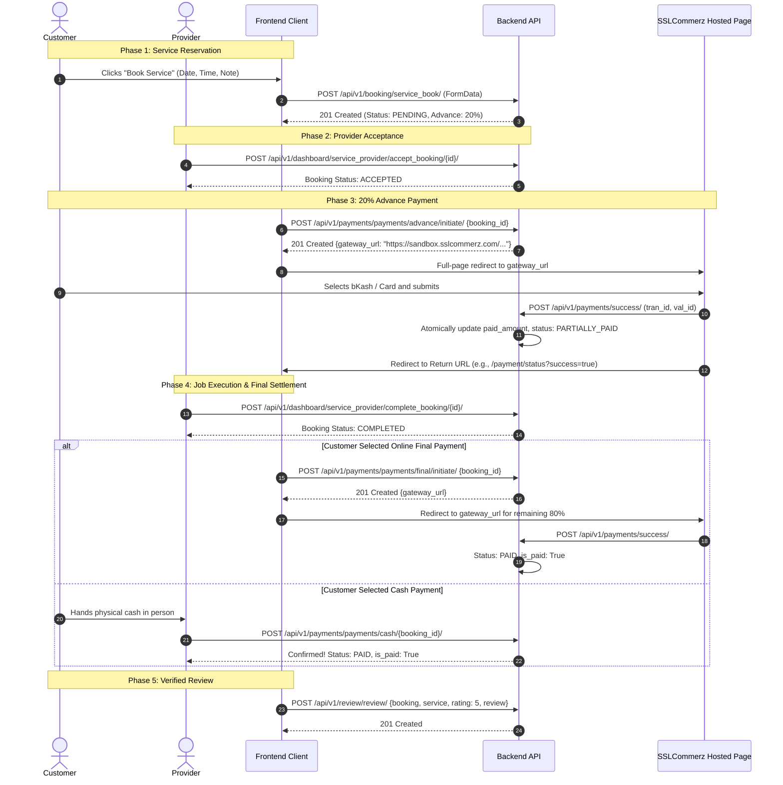

# 💻 Frontend & AI Integration Workflow

> **Document ID:** `DOC-04-FRONTEND-AI`  
> **System Version:** 1.0.0  
> **Target Audience:** Frontend Engineers, Full-Stack Developers, Autonomous AI Agents building client apps

---

## 1. Architectural Guidance for Client Applications

When implementing or extending frontend clients (Web: Next.js / React / Vue; Mobile: React Native / Flutter) interacting with the **Local Service Finder API**, follow the architectural specifications outlined in this guide.

### 1.1 Recommended Frontend Stack
- **Framework:** Next.js (App Router) or React (Vite)
- **State Management & Data Fetching:** TanStack Query (`@tanstack/react-query`) for automated caching, polling, and cache invalidation.
- **HTTP Client:** Axios with centralized request/response interceptors.
- **Form Management & Validation:** React Hook Form + Zod matching DRF serializer schemas.
- **Styling & Components:** Tailwind CSS + Radix UI / Shadcn UI.
- **Icons:** Lucide React.

---

## 2. Authentication & Token Management Lifecycle



### 2.1 Axios Interceptor Pattern
Configure a singleton Axios instance to automatically attach the JWT Bearer header:

```typescript
// lib/apiClient.ts
import axios from 'axios';

const API_BASE_URL = process.env.NEXT_PUBLIC_API_BASE_URL || 'http://127.0.0.1:8000/api/v1';

export const apiClient = axios.create({
  baseURL: API_BASE_URL,
  headers: {
    'Content-Type': 'application/json',
  },
});

// Request Interceptor: Attach Access Token
apiClient.interceptors.request.use((config) => {
  const token = typeof window !== 'undefined' ? localStorage.getItem('access_token') : null;
  if (token && config.headers) {
    config.headers.Authorization = `Bearer ${token}`;
  }
  return config;
});

// Response Interceptor: Handle Token Expiration
apiClient.interceptors.response.use(
  (response) => response,
  async (error) => {
    const originalRequest = error.config;
    if (error.response?.status === 401 && !originalRequest._retry) {
      originalRequest._retry = true;
      // If refresh token mechanism is configured:
      // Request new token or redirect to /auth/login
      if (typeof window !== 'undefined') {
        localStorage.removeItem('access_token');
        window.location.href = '/login?expired=true';
      }
    }
    return Promise.reject(error);
  }
);
```

### 2.2 Role-Based Route Guards
The client must inspect the decoded JWT token or user profile to safeguard role-specific routes:
1. **Customer Routes (`/customer/*`):** Requires `role === "CUSTOMER"`.
2. **Provider Routes (`/provider/*`):** Requires `role === "SERVICE_PROVIDER"` AND `is_approved === true`.
3. **Pending Verification Route (`/provider/pending`):** Displayed when `role === "SERVICE_PROVIDER"` and `is_approved === false`.
4. **Admin Routes (`/admin/*`):** Requires `role === "ADMIN"`.

---

## 3. Core User Journeys & State Transitions

### 3.1 Cascading Location Dropdowns
Before searching services or creating user profiles, clients must populate the geographic hierarchy:



### 3.2 Hyper-Local Service Search Workflow
The search endpoint (`/api/v1/service/search_service/`) enforces location matching:
- **Mandatory Query Params:**
  - `upazila`: The selected Upazila name (e.g., `Mirpur`).
  - `area`: The specific neighborhood/area (e.g., `Block D`).
  - `search`: Keyword string matching service name, description, or category.
- **Frontend Best Practices:**
  - Debounce keyword inputs by **350ms** before triggering query.
  - If results return `404 Not Found`, render an empty state: *"No verified technicians found in your immediate area. Try searching an adjacent neighborhood."*

---

## 4. End-to-End Booking & Two-Stage Payment Flow

The payment orchestration requires precise coordination between the client, backend, and the SSLCommerz hosted gateway:



### 4.1 Payment Initiation Code Sample
```typescript
// features/payments/api.ts
export async function initiateAdvancePayment(bookingId: number) {
  const response = await apiClient.post('/payments/payments/advance/initiate/', {
    booking_id: bookingId,
  });
  
  const { gateway_url } = response.data;
  if (gateway_url) {
    // Redirect customer directly to SSLCommerz hosted payment gateway
    window.location.href = gateway_url;
  }
}
```

---

## 5. Screen Inventory & UX Specifications

| Screen / View | Route Path | Target Role | Key Controls & Data Elements |
|---|---|---|---|
| **Public Landing** | `/` | All / Guests | Category carousel, location quick-selector, featured services. |
| **Service Search** | `/services` | All / Customer | Filter bar (Division, District, Upazila, Area, Search input), service card grid with price badges and ratings. |
| **Service Details** | `/services/[id]` | All / Customer | Provider bio, rating breakdown, base price, "Book Now" CTA modal. |
| **Booking Modal** | Modal dialog | Customer | Date picker, time slot selector, special instructions text area, 20% advance calculation summary. |
| **Customer Dashboard** | `/dashboard/customer` | Customer | Tabs: "All Orders", "Pending Approval", "Completed"; action button: "Pay Advance" (active on `accepted` status); "Review" button (active on `completed` status). |
| **Provider Dashboard** | `/dashboard/provider` | Service Provider | Metric counters (Accepted, Completed); "Pending Requests" queue with "Accept" / "Reject" buttons; "Mark Completed" button; "Confirm Cash" button. |
| **Service Manager** | `/dashboard/provider/services` | Service Provider | List of published services, "Add New Service" form supporting image upload via `FormData`. |
| **Admin Panel** | `/dashboard/admin` | Admin | Metrics cards (total active, pending); table of pending provider applications with one-click "Approve & Activate" button. |

---

## 6. Error Handling & Validation Patterns

DRF returns standard JSON formatted error objects. Client applications must parse and display field-level errors consistently:

### 6.1 Parsing DRF Validation Errors
```typescript
// utils/errorHandler.ts
export function formatApiErrors(error: any): string {
  if (error.response?.data) {
    const data = error.response.data;
    
    // Check for generic message or detail string
    if (typeof data.message === 'string') return data.message;
    if (typeof data.detail === 'string') return data.detail;
    if (typeof data.error === 'string') return data.error;

    // Check for DRF serializer field validation dictionary
    if (typeof data === 'object') {
      const fieldErrors = Object.entries(data)
        .map(([field, msgs]) => `${field}: ${Array.isArray(msgs) ? msgs.join(', ') : msgs}`)
        .join(' | ');
      return fieldErrors || 'An unexpected validation error occurred.';
    }
  }
  return error.message || 'Network error occurred. Please try again.';
}
```

### 6.2 Expected Status Code Handling
- `400 Bad Request`: Field validation error (e.g., trying to book hourly service directly, invalid OTP).
- `401 Unauthorized`: Token expired or invalid credentials; redirect to login.
- `403 Forbidden`: Role mismatch (e.g., Customer accessing Provider endpoints).
- `404 Not Found`: Service or profile query returned no matching entities.
- `409 Conflict`: Attempted duplicate payment while another transaction is pending. Display: *"A payment transaction is already pending. Please wait 2 minutes or check status."*
- `502 Bad Gateway`: SSLCommerz payment gateway temporarily unavailable.
