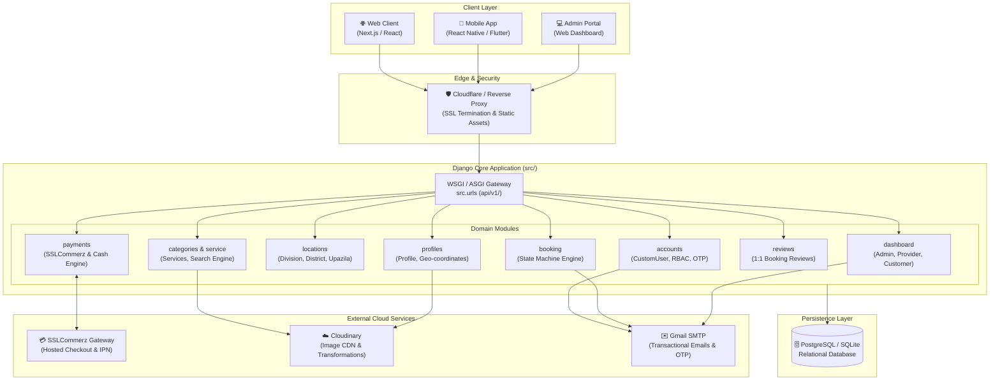
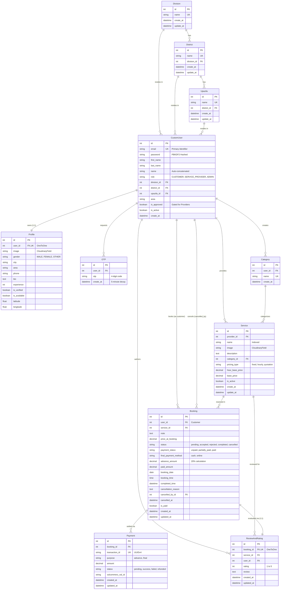
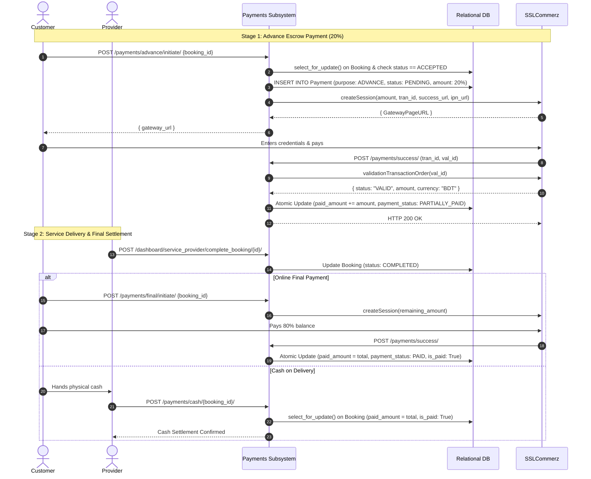
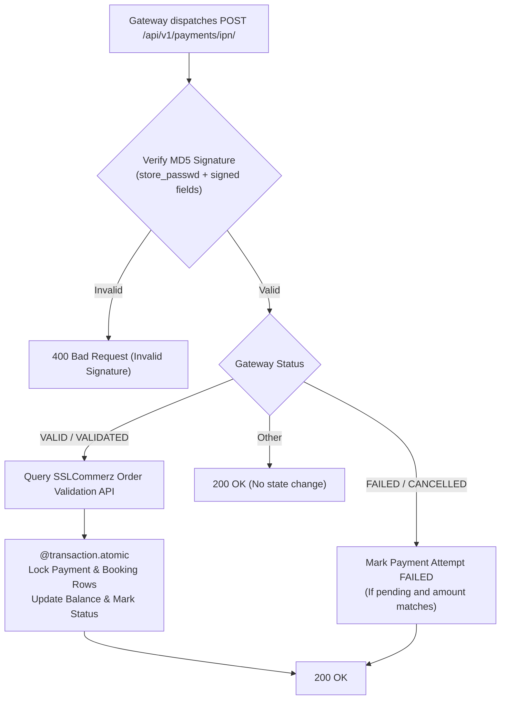
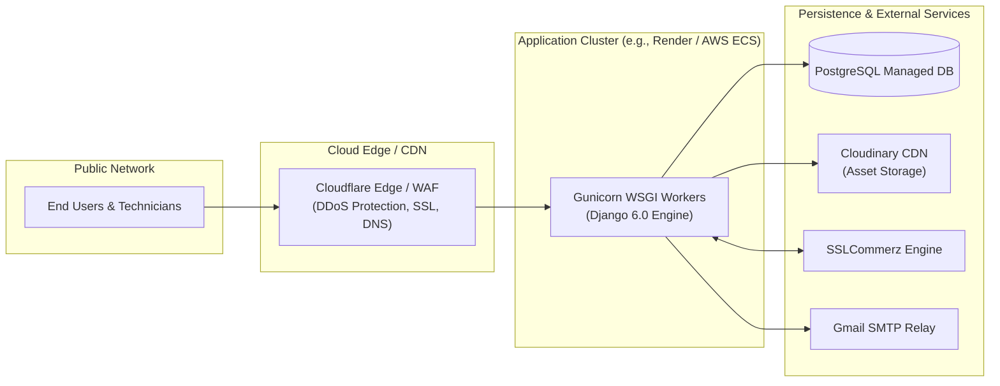

# 🏛️ System Architecture & Engineering Blueprint

> **Document ID:** `DOC-07-ARCHITECTURE`  
> **System Version:** 1.0.0  
> **Status:** Production Architecture Blueprint  
> **Target Audience:** Solution Architects, DevOps/SREs, Backend Engineers

---

## 1. High-Level System Architecture

The **Local Service Finder System** is built as a cloud-ready, API-first monolithic application with external micro-integrations for media management, transaction processing, and notification delivery:

---

## 2. Database Entity-Relationship (ER) Blueprint

The diagram below details the entity schemas, key constraints, and relational cardinalities:

---

## 3. Core Operational Data Flows

### 3.1 Two-Stage Payment Lifecycle Flow
The payment pipeline handles advance and final settlements with built-in concurrency locks and double-spend safeguards:

### 3.2 Asynchronous IPN (Instant Payment Notification) Handling
To protect against drop-offs where the user's browser closes before the success URL callback fires, SSLCommerz dispatches server-to-server IPN requests:

---

## 4. Scalability, Concurrency & Security Engineering

### 4.1 Database Optimization Strategies
1. **Targeted B-Tree Indexing:**
   - Field `name` on `Service` is configured with `db_index=True` for high-throughput substring lookups.
   - Field `transaction_id` on `Payment` is marked `unique=True`, auto-generating a unique B-Tree index for instantaneous verification queries.
2. **Selective Eager Loading (`select_related`):**
   - Critical read paths utilize Django's `select_related()` to avoid $N+1$ query overhead (e.g., `Payment.objects.select_related("booking")`).
3. **Pessimistic Concurrency Locking:**
   - Financial mutations execute within `@transaction.atomic` blocks utilizing `select_for_update()`. This locks the row against simultaneous callbacks, preventing race conditions or double-crediting balances.

### 4.2 Security Architecture
- **Stateless Authorization:** JWT Bearer tokens isolate authentication from database session tables, enabling horizontal backend scaling.
- **Defense in Depth on Webhooks:** IPN payloads are verified through a combination of HMAC-MD5 cryptographic signature checks, currency verification (`BDT`), and order validation lookups directly back to the gateway.
- **Sensitive Data Isolation:** Database URLs, JWT secrets, SMTP passwords, and payment gateway keys are decoupled from codebase source control via `python-decouple`.

---

## 5. Deployment Topology & Infrastructure Layout

- **Runtime Process:** Python application managed by Gunicorn (`gunicorn src.wsgi:application`) with autoscale worker threads.
- **Database Backend:** Managed PostgreSQL provisioned via `DATABASE_URL` (configured via `dj_database_url.parse()`).
- **Static & Media File Assets:**
  - Static CSS/JS served directly via Whitenoise or Reverse Proxy.
  - User and service image uploads streamed directly to Cloudinary CDN via the `cloudinary` SDK.
